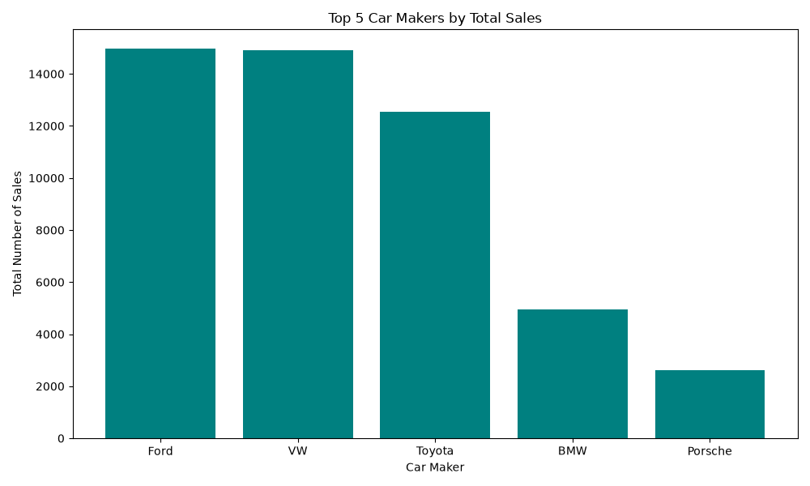
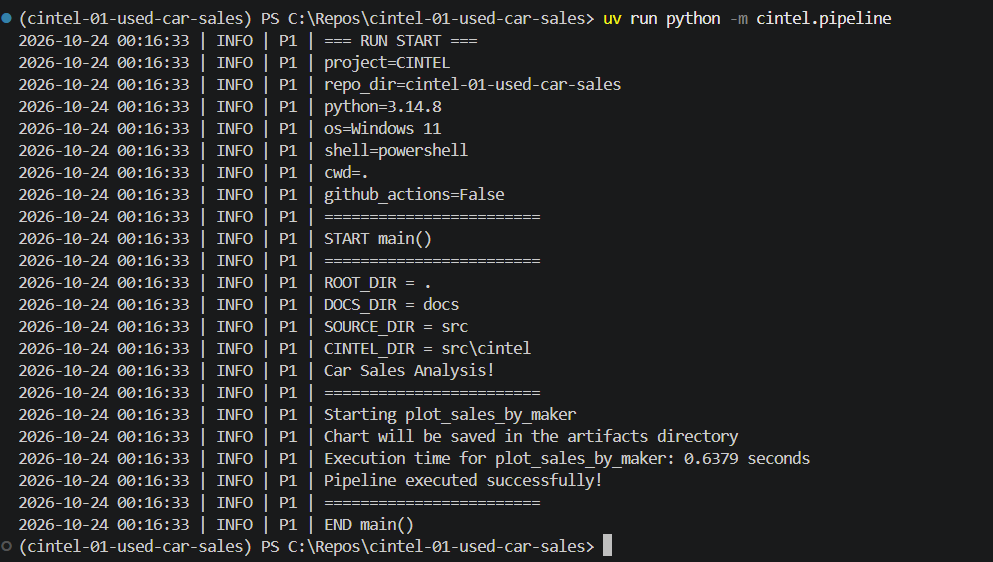

# Used Car Sales in the United States — Continuous Intelligence

**Author:** Anindya Bose  
**Date:** 2026-10-23  
**Course:** Continuous Intelligence — Northwest Missouri State University

This project establishes a professional Python development environment and demonstrates how a Python pipeline can be configured, executed, and verified. It processes United States used car sales data to identify market distribution, track system processing speeds, and serve as a foundation for continuous intelligence applications.

## Data

The project utilizes a locally stored CSV dataset containing historical information about used car sales in the United States. The application reads this data source using pandas, aggregates the records by vehicle manufacturer, and ranks them to isolate the top 5 highest-selling brands. Finally using matplotlib it generates a bar chart showing top 5 manufacture by number of used car sales. The generated bar chart is automatically saved directly to a designated (**`artifacts`**) project directory for long-term tracking and downstream reporting.

## Techniques Applied

This project demonstrates several professional Python development tools and techniques:

* **Python:** Executes the project's application logic.
* **pandas:** Handles high-performance data ingestion, parsing, and analytical grouping.
* **matplotlib:** Renders clean, custom visual bar charts of the analytical data.
* **uv:** Manages Python versions, virtual environments, and project dependencies.
* **Git and GitHub:** Track changes and maintain project history.
* **Visual Studio Code:** Provides the development environment for writing, editing, and executing code.
* **Structured logging:** Records execution information, directory states, and granular performance metrics.
* **Ruff:** Supports Python code formatting and linting.
* **pytest:** Supports automated Python unit testing and code coverage metrics.
* **prek:** Manages Git hooks and automated quality checks.
* **Zensical and GitHub Pages:** Support the creation and publication of project documentation.

These tools establish a structured and reproducible workflow for developing, testing, and maintaining Python applications.

## Custom Modifications

This project was created using Dr. Denise Case's `cintel-01-getting-started` GitHub template.

The following customizations were completed:

1. Created a new public GitHub repository named `cintel-01-used-car-sales`.
2. Created another python file to separate data processing logic from the pipeline.py file
3. Customized the pipeline.py to add function call and measure the performance of the function call.
4. Updated the Python source files to include my name and the date.
5. Modified the logging output to display a personalized project message and track execution thresholds.
6. Configured the Python development environment and installed project dependencies.
7. Installed, updated, and executed automated Git hook checks using `prek`.

The personalized logging message is:

```text
Car Sales Analysis!
========================
Starting plot_sales_by_maker
Chart will be saved in the artifacts directory
```

These changes establish ownership of the project while preserving the original Python pipeline structure.

## Methods and Settings

The project uses the following development configuration:

| Component | Configuration |
|---|---|
| Operating System | Windows 11 |
| Python Version | 3.14.8 |
| Environment Manager | uv |
| Virtual Environment | `.venv` |
| Runtime Dependency | `datafun-toolkit`, `pandas`, `matplotlib` |
| Python Package | `cintel` |
| Source File | `src/cintel/pipeline.py` |
| Repository | `cintel-01-used-car-sales` |

The Python application is executed from the project root using:

```powershell
uv run python -m cintel.pipeline
```

The pipeline uses the `datafun-toolkit` package to provide logging functionality.

Logging records information about the execution environment, project directories, application activity, and exact processing timers.

No statistical thresholds, rolling windows, anomaly detection algorithms, or analytical models have been implemented in this introductory version.

## Verification

Several checks were performed to confirm that the development environment and Python application were functioning correctly.

### Development Environment

* Verified the installation of Git and Visual Studio Code.
* Installed and verified Python 3.14.8.
* Created an isolated Python virtual environment using `uv sync`.
* Successfully resolved and installed required Python packages.
* Completed a dependency audit with no known vulnerabilities reported among the audited packages.

### Code Quality

Git hooks were installed and executed using prek.

```powershell
uvx prek run --all-files
```

The applicable checks passed, including trailing whitespace validation, end-of-file newline verification, line ending normalization, and Ruff formatting and linting.

### Pipeline Execution

The application was executed using:

```powershell
uv run python -m cintel.pipeline
```

The terminal displayed the following confirmation:

```text
Pipeline executed successfully!
```

The execution completed without an error.

## Results

The Python pipeline executed successfully, generated informational logging output, and recorded precise performance benchmarks.

The execution identified the project's operating system, Python version, repository directory, and relevant source and documentation directories.

The output also included the customized project message and tracked that the plotting function executed in **0.28 seconds**.

### Execution Evidence

The successfully rendered visualization has been written to the automated output folder.



### Confirmed Results



These results demonstrate that the project can execute its introductory Python pipeline within the configured development environment.

## Observations

The terminal output provides the following observations:

1. The application executed using Python 3.14.8.
2. The operating system was identified as Windows 11.
3. The repository and project directories were identified correctly.
4. The customized project message appeared in the output.
5. The execution speed of the calculation was logged successfully.
6. The program displayed the expected success message.
7. The pipeline completed without a reported execution error.

The output contains clean environment information, logging messages, and analytical results.

## Interpretation and Insights

The successful execution demonstrates that the development environment and Python project configuration are functioning correctly.

The project also illustrates the importance of organizing Python applications into reusable modules and maintaining execution records through logging.

In professional analytics work, these practices can improve reproducibility, troubleshooting, and maintenance.

The current project establishes a technical foundation that could eventually support automated project performance monitoring.

However, additional development would be required before the application could collect data, identify trends, or support operational decisions.

## Limitations

The project currently serves as an introductory Python development and environment verification application.

Its limitations include:

* No real-world project performance dataset.
* No automated collection of incoming operational data.
* No response-time calculations.
* No statistical analysis or anomaly detection.
* No continuous monitoring functionality.
* No dashboard or analytical reporting interface.

The successful execution verifies the introductory pipeline but does not demonstrate a completed continuous intelligence monitoring system.

## Next Steps

Future development could expand the project into a project performance monitoring application.

Potential enhancements include:

1. **Data Collection:** Introduce a sample dataset containing project requests, submission dates, completion dates, and response times.
2. **Performance Metrics:** Calculate average response times, completion rates, and outstanding requests.
3. **Automated Team Standards:** Implement custom Git hooks to automatically run linter, formatter, type checker, and tester suites to ensure teammate commits match repository standards before pushes are authorized.
